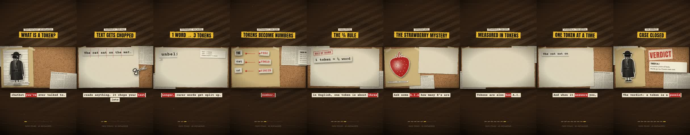

# case-file-video

A Claude skill that turns any knowledge topic into a ~60-second vertical explainer video in a noir **"case file"** style: halftone photos cut out of newsprint, ransom-note word clippings, red stamps, pins and red string on a cork board, all moving like stop-motion paper.



Each run produces:
- **A playable web page**: browser speech narration, a generated noir-jazz score and paper sound effects, word-synced captions.
- **An MP4**: 1080×1920, 30 fps, with an offline neural voice (Kokoro), ready for Shorts, Reels or TikTok.

## Install

**Claude Code**: copy the skill folder into your skills directory:
```bash
git clone https://github.com/<you>/<this-repo>.git
mkdir -p ~/.claude/skills && cp -r <this-repo>/case-file-video ~/.claude/skills/
```

**Claude app**: zip the `case-file-video` folder (with `SKILL.md` at the top of the zip folder) and upload it as a custom skill in Claude's settings.

## Use
Ask Claude something like *"Make a case-file video explaining how vaccines work"*. The skill writes the script, builds the scenes, checks them, and exports the MP4.

## Requirements (installed by the skill when missing)
Node 18+, Python 3.10+, ffmpeg, Playwright + Chromium, and the Python packages `kokoro-onnx`, `soundfile`, `opencv-python-headless`, `scipy`, `pillow` and `numpy`. The Kokoro model files (~120 MB) are downloaded from the kokoro-onnx GitHub releases.

## Layout
```
case-file-video/
  SKILL.md                 instructions Claude follows
  scripts/
    engine.template.html   the player engine + worked example ("What is a token?")
    render_svgs.js         SVG props -> PNG
    stickers.py            PNG -> halftone newsprint cutouts (embedded in the page)
    build.py               inlines cutouts into the page
    check.js               headless QA (poster frames, playthrough)
    narrate.py             Kokoro narration + word timings
    export.js              frame-accurate MP4 export
  assets/
    svg/                   reusable props (robot detective, magnifier, scissors, coins, ...)
    stickers.example.json  cutout spec example
    pron.example.json      pronunciation fixes example
```
